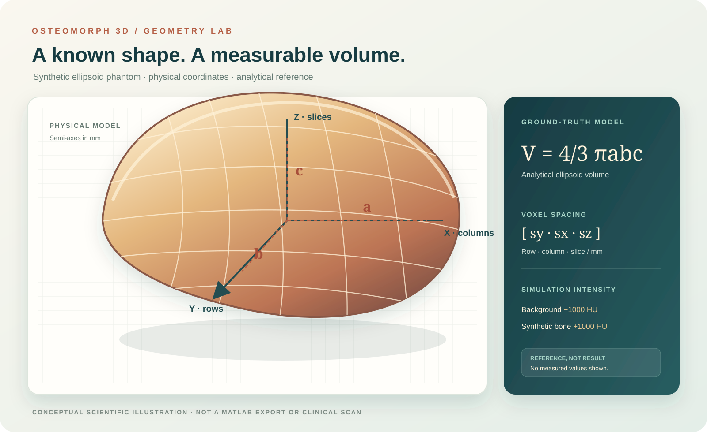
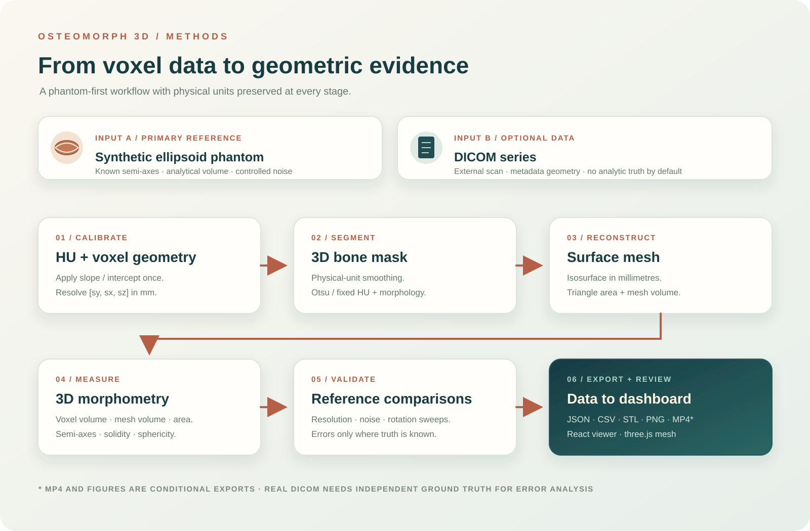
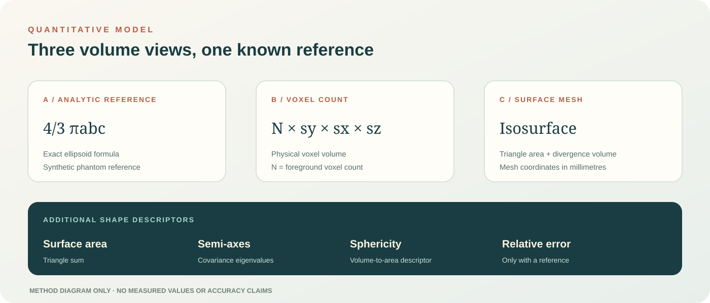
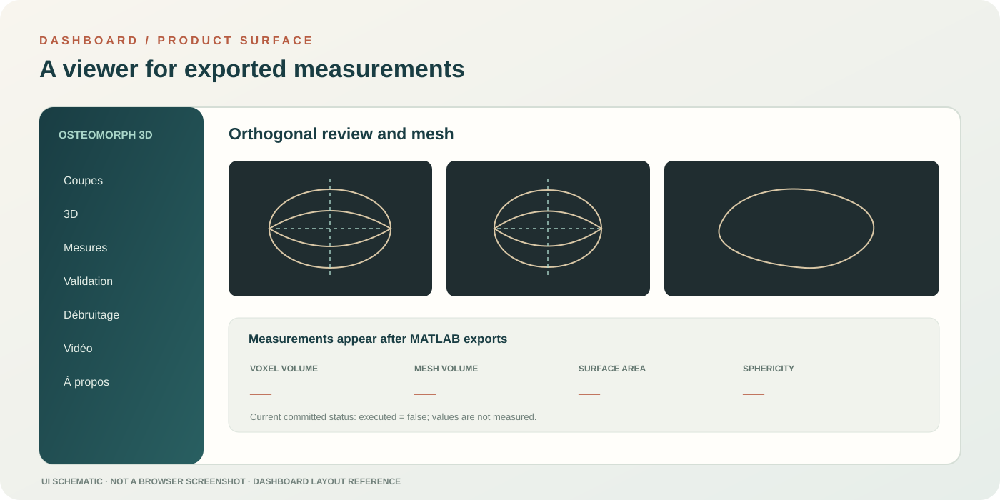

# OsteoMorph3D
### 3D Bone Morphometry from CT · MATLAB · Synthetic Phantom Validation

> An academic biomedical-image-processing project exploring how voxel geometry, 3D segmentation and surface reconstruction affect bone-like shape measurements. The primary reference is a synthetic ellipsoid with a known analytical volume. Optional DICOM input is supported; this repository is **not a clinical tool**.

## Project at a glance

| Component | What is implemented |
|---|---|
| Synthetic reference | 3D ellipsoid phantom with known semi-axes and analytical volume |
| Image geometry | Physical voxel spacing in mm, including anisotropic grids |
| DICOM handling | HU rescaling applied once; slice spacing derived from image positions when available |
| Segmentation | 3D Gaussian smoothing, Otsu or fixed HU threshold, morphology and largest connected component |
| Morphometry | Voxel volume, mesh area, mesh volume, semi-axes, solidity and sphericity |
| Validation design | Voxel-size, noise and rotation experiments against synthetic ground truth |
| Export | JSON, CSV, STL, PNG slice previews and optional MP4 |
| Viewer | React 18, Vite, React Router and three.js |

> **Current result status:** the source code, tests and dashboard are in the repository, but MATLAB-generated result files are not. The dashboard status is deliberately `executed: false`. No measured volume, area, axis, error, PSNR or SSIM is claimed in this README.

## Why a synthetic phantom?

The project starts with a controlled geometric object instead of claiming that an unlabelled clinical CT scan has known ground truth. The ellipsoid semi-axes a, b and c are specified in millimetres, so its exact volume can be calculated independently:

**Analytical volume:** V = 4/3 × π × a × b × c

The raster reference is computed separately from the number of foreground voxel centres and the voxel dimensions:

**Voxel volume:** V = Nforeground × sy × sx × sz

Spacing is stored in MATLAB image order [sy, sx, sz] = [row, column, slice]. Semi-axes are ordered along [x, y, z] = [column, row, slice]. The two representations are kept distinct to avoid mixing physical axes and array indices.

## Processing workflow

1. **Input** — create a reproducible ellipsoid phantom, or optionally read a supplied DICOM series.
2. **Geometry and calibration** — convert stored values to HU using RescaleSlope and RescaleIntercept exactly once; determine physical voxel spacing.
3. **Segmentation** — apply optional smoothing in physical units, Otsu or a fixed HU threshold, then 3D cleanup and largest-component selection.
4. **Surface reconstruction** — create an isosurface in millimetre coordinates.
5. **Morphometry** — calculate voxel volume, mesh volume, mesh area, semi-axes and shape descriptors.
6. **Validation** — compare against the analytical phantom reference and run parameter sweeps.
7. **Export and review** — save result files for the React dashboard and three.js mesh viewer.

## Measurement framework

| Quantity | Implementation / interpretation |
|---|---|
| Voxel volume | Foreground voxel count × sy × sx × sz |
| Mesh volume | Surface mesh volume calculated with the divergence theorem |
| Mesh area | Sum of triangle areas |
| Semi-axes | Covariance eigenvalues of voxel centres in physical coordinates, with the voxel-extent correction described in the source |
| Solidity | Region occupancy descriptor from the 3D binary mask |
| Sphericity | π^(1/3) × (6V)^(2/3) / A |
| Relative error | Calculated only where a valid reference is available |

For a synthetic phantom, analytical volume, reference surface area and true semi-axes are available. For an ordinary DICOM series, those references are unknown unless an independent ground-truth annotation or reference measurement is supplied. In that case, reference-error fields remain empty.

## Dashboard preview

The existing React dashboard is a research viewer for exported data. It includes:

- **Coupes** — axial, coronal and sagittal views with window/level controls.
- **3D** — STL mesh viewer powered by three.js.
- **Mesures** — physical geometry and morphometry fields.
- **Validation** — validation sweep and error plots.
- **Débruitage** — classical-filter comparisons and their effect on volume.
- **Vidéo** — optional mesh-rotation export.
- **À propos** — methods, technologies and limitations.

The dashboard reads files from dashboard/public/data. Until exports exist, unmeasured quantities are displayed as an em dash (—). The committed status file currently says `executed: false`.

**Visual honesty:** the figures above are original explanatory diagrams, not screenshots or measured outputs from MATLAB. No patient CT images, STL mesh, validation plot, denoising result or genuine populated-dashboard screenshot is currently committed. Real output galleries should be added after a local MATLAB run.

## Technical method

### 1. Phantom generation

The generator in src/generateEllipsoidPhantom.m builds a solid 3D ellipsoid and returns both its binary mask and HU volume. Current defaults are configuration settings, not findings:

- Semi-axes are drawn uniformly from 12 to 36 mm when not supplied.
- Default spacing is [1, 1, 1] mm in row / column / slice order.
- Simulated background and bone intensities default to −1000 HU and +1000 HU.
- Gaussian noise is added after the geometric mask is built; the reference mask and analytical volume therefore remain known.
- A random seed makes phantom generation reproducible.

### 2. DICOM and HU conversion

src/readVolumeHU.m accepts a phantom structure or DICOM folder. The DICOM conversion is:

**HU = StoredValue × RescaleSlope + RescaleIntercept**

In-plane spacing comes from PixelSpacing. Through-plane spacing is derived from the distance between slice centres along the slice normal when image positions are available, or from SpacingBetweenSlices when appropriate. SliceThickness is retained as a separate metadata field and is not substituted for slice spacing. Missing spacing is not silently replaced with an assumed 1 mm. Identifying DICOM attributes are not copied into result exports.

### 3. Segmentation

src/segmentBone.m applies optional 3D Gaussian smoothing, Otsu threshold estimation or a fixed threshold (default 300 HU), followed by optional opening/closing, hole filling, minimum-volume cleanup and largest 26-connected component selection. The physical sigma and morphology radii are converted using anisotropic voxel spacing. Morphology radii default to zero to avoid silently removing a boundary shell.

A bright scanner table may remain connected to the target if it touches the same component. The current largest-component rule does not claim to resolve that situation.

### 4. Mesh and morphometry

src/meshAndMeasure.m produces an isosurface in physical coordinates, triangle-based area, divergence-theorem mesh volume, covariance-derived semi-axes and additional shape descriptors. The source keeps voxel-space principal-axis lengths distinct from physical semi-axes in millimetres.

### 5. Validation design

src/validatePhantoms.m defines experiments with the following configured conditions:

| Factor | Conditions in the code |
|---|---|
| Isotropic voxel size | 0.5, 1 and 2 mm |
| Added Gaussian noise | 0 and 100 HU |
| Rotation | 0° and 30° |

These are planned experimental conditions, not observed results. When executed, the validation function calculates relative errors for voxel volume, mesh volume, surface area and semi-axes, plus threshold and rotation comparisons. No accuracy threshold or precomputed error range is claimed.

### 6. Denoising comparison

src/compareDenoising.m compares available classical methods: Gaussian, median, bilateral, non-local means, Wiener and optional wavelet denoising. It records PSNR, SSIM when the relevant function is available, and volume change. Wavelet denoising depends on Wavelet Toolbox; an unavailable method must remain unavailable rather than receiving a placeholder score.

## Repository map

    .github/workflows/   GitHub repository checks
    src/                 MATLAB phantom, DICOM, segmentation, mesh and validation code
    tests/               matlab.unittest suites
    dashboard/           React + Vite research viewer
    dashboard/public/data/  Export contract and initial status.json
    docs/                Project plans and explanatory figures
    data/                Local input location (not committed)
    results/              Runtime exports (not committed)
    runProject.m          Experiment and export entry point

## Requirements

- MATLAB R2022b or newer.
- Image Processing Toolbox.
- Wavelet Toolbox is optional and only needed for wavelet denoising.
- Node.js and npm for the dashboard.

Check the MATLAB installation and required toolbox from MATLAB:

    ver
    license('test', 'Image_Toolbox')

## Run locally on Windows

From the repository root, run the MATLAB unit tests:

    matlab -batch "runtests('tests')"

After reviewing the test report, run the experiment and generate its exports:

    runProject

The project writes files under results and mirrors supported outputs to dashboard/public/data when that directory exists. Expected output types include result and denoising JSON, validation and batch CSV, STL mesh, slice previews and an optional rotation video. These files are generated at runtime and are not included in the current repository snapshot.

Start the dashboard:

    cd dashboard
    npm install
    npm run dev

Open the local Vite URL printed in the terminal. Do not open dashboard/index.html directly via file:// because the dashboard loads JSON assets over HTTP.

## Tests and GitHub Actions

The MATLAB test suites cover:

- PhantomGenerationTest.m — analytical formula, raster volume, reproducibility and invalid inputs.
- PipelineTest.m — HU rescaling, DICOM geometry, physical volume and segmentation contracts.
- ExportTest.m — export consistency, generated validation calculations and file content.
- DashboardContractTest.m — status contract, units, unmeasured sentinel and dashboard rules.

**GitHub Actions does not execute MATLAB.** The current checks workflow is a repository-honesty and file-contract check. A green Actions badge is not evidence that MATLAB tests or numerical experiments passed. Run the tests locally with MATLAB and the required toolbox to establish that evidence.

## Scope and limitations

- Academic engineering prototype; not intended for diagnosis, treatment or clinical decision-making.
- The analytical ground truth is a mathematical ellipsoid, not a manually annotated clinical bone.
- Synthetic HU values and noise settings are controlled simulation inputs, not a scanner noise model.
- Largest-component segmentation can fail when unrelated structures touch the target.
- Mesh measurements depend on grid resolution, surface extraction and smoothing parameters.
- DICOM support does not establish performance on a representative clinical cohort.
- No patient data, clinical validation or diagnostic performance claim is included.

## Next evidence to add

After a successful MATLAB run, replace the conceptual previews with genuine project outputs:

1. Axial, coronal and sagittal screenshot with HU window / level labels.
2. Actual STL surface screenshot with physical axes and scale.
3. Validation plots generated from validation.csv, with each condition labelled.
4. Denoising comparison from denoise.json, clearly marking unavailable methods.
5. Dashboard screenshot whose metrics can be traced to the exported files.

Review all DICOM-derived exports for identifying metadata before publishing. Do not commit identifiable patient images.

---

**Primary language:** MATLAB · **Dashboard:** React / Vite / three.js · **Domain:** Biomedical image processing and 3D geometry · **Status:** Academic / non-clinical